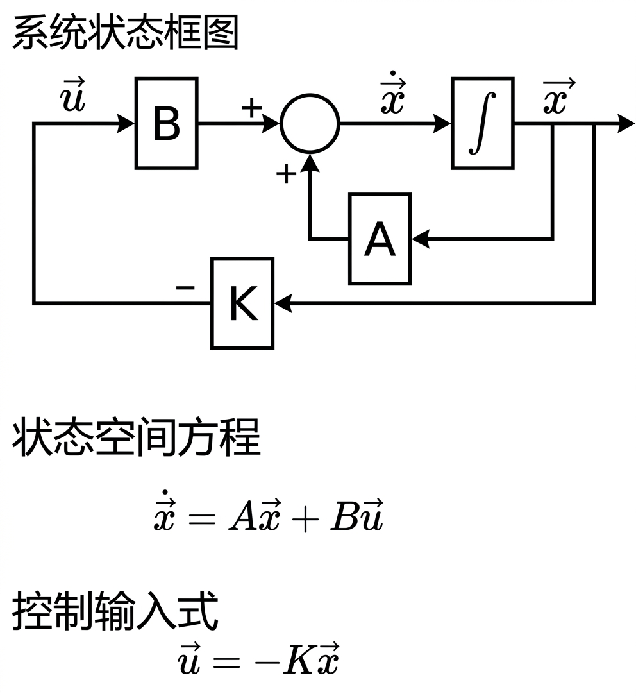

# 五连杆轮腿机器人

简体中文 | [English](README_en.md)

[](#系统结构)
[](#系统结构)
[](#代码结构)

五连杆腿机构的轮腿式自平衡机器人。已完成运动学正逆解、LQR 自平衡与 VMC 虚拟模型控制，目前处于硬件联调阶段。



## 目录

- [项目简介](#项目简介)
- [系统结构](#系统结构)
- [代码结构](#代码结构)
- [快速开始](#快速开始)
- [文档](#文档)
- [进度](#进度)
- [本地工具](#本地工具)
- [参考](#参考)

## 项目简介

轮腿机器人用「轮」保证高效移动、用「腿」适应复杂地形。本项目采用五连杆闭式链作为腿部机构，由双电机驱动，通过虚拟模型控制（VMC）把期望的腿长与摆角解算成关节力矩，再由 LQR 完成整机自平衡。

主要工作：

- 五连杆机构运动学正解、逆解推导（见 [文档](#文档)）
- 倒立摆模型线性化，推导状态空间方程并求解 LQR 增益
- VMC 虚拟模型控制、串级 PID、姿态解算（EKF / Mahony）
- FreeRTOS 多任务框架：底盘控制、姿态解算、观测器、遥控输入
- 达妙 DM4310 电机 FDCAN 驱动、BMI088 IMU 驱动

## 系统结构

| 模块 | 型号 / 说明 |
| --- | --- |
| 主控 | STM32H723VGT6（Cortex-M7，480 MHz） |
| 姿态传感器 | BMI088（SPI，6 轴 IMU） |
| 关节电机 | 达妙 DM4310 × 4（FDCAN 总线） |
| 遥控输入 | Xbox 手柄 / PS2 手柄（UART） |
| 实时系统 | FreeRTOS |
| 驱动库 | STM32H7 HAL + CMSIS |
| 开发环境 | Keil MDK 5 / STM32CubeMX |

## 代码结构

```
.
├─ src/                  固件工程（CubeMX 生成 + 自研模块）
│  ├─ Core/              外设初始化、main.c、freertos.c、中断
│  ├─ User/              自研代码
│  │  ├─ APP/            FreeRTOS 任务：底盘 L/R、INS、观测器、遥控、看门狗
│  │  ├─ Algorithm/      VMC（五连杆）、PID、EKF、Kalman、Mahony
│  │  ├─ Controller/     控制器主体
│  │  ├─ Devices/        BMI088、DM4310 驱动
│  │  ├─ Bsp/            DWT 计时、PWM、CAN、UART
│  │  └─ Lib/            通用工具函数
│  ├─ Drivers/           ST 官方 HAL 与 CMSIS
│  ├─ Middlewares/       FreeRTOS 内核
│  └─ MDK-ARM/           Keil MDK 工程
├─ docs/                 学习笔记与公式推导
├─ assets/               结构图、实物照片
└─ tools/                本地自动化脚本（提交推送、版本回退）
```

更细的说明见 [`src/readme.md`](src/readme.md)。

## 快速开始

**编译与烧录**

```text
1. 安装 Keil MDK 5 与 STM32H7 器件支持包
2. 打开 src/MDK-ARM/CtrlBoard-H7_IMU.uvprojx
3. F7 编译，F8 下载（ST-Link / J-Link）
```

**修改外设配置**

用 STM32CubeMX 打开 `src/CtrlBoard-H7_IMU.ioc`，修改后重新生成代码，注意 **不要覆盖** `src/User/` 下的自研代码。

## 文档

| 文档 | 内容 |
| --- | --- |
| [五连杆轮腿机器人运动学正逆解](docs/五连杆轮腿机器人运动学正逆解.md) | 五连杆闭式链的正解、逆解推导 |
| [LQR-最优反馈与变高度自平衡](docs/LQR-最优反馈与变高度自平衡.md) | LQR 设计、变腿长对平衡的影响 |
| [基于倒立摆推导状态空间方程](docs/基于倒立摆推导状态空间方程.md) | 倒立摆建模与线性化 |

配图在 `docs/` 与 `assets/` 目录下。

## 进度

- [x] 五连杆机构运动学正解：由关节角 α、β 求轮轴中心位置
- [x] 运动学逆解
- [x] 腿部与轮速 PID 控制
- [x] LQR 自平衡
- [x] VMC 虚拟模型控制
- [x] Xbox / PS2 遥控接入
- [ ] 硬件联调与参数整定

## 本地工具

`tools/` 下是对日常开发有帮助的脚本（仅 Windows，需要已安装 Git）：

| 文件 | 作用 |
| --- | --- |
| `启动自动同步.cmd` | 双击启动，此后改动保存后自动提交并推送到 GitHub |
| `打开代码管理.cmd` | 中文图形界面：一键上传 / 一键回退到任意历史版本 |
| `auto-sync.ps1` | 上面的自动同步脚本本体 |
| `git-gui.ps1` | 上面的图形界面本体 |

## 参考

- Kevin M. Lynch, Frank C. Park. *Modern Robotics: Mechanics, Planning, and Control*. Cambridge University Press, 2017.
- Modern Robotics 课程视频（Northwestern University）：[播放列表](https://www.youtube.com/watch?v=jVu-Hijns70&list=PLggLP4f-rq02vX0OQQ5vrCxbJrzamYDfx)
- [What Is Linear Quadratic Regulator (LQR) Optimal Control? | State Space, Part 4](https://www.youtube.com/watch?v=E_RDCFOlJx4)（MATLAB Tech Talks）

## 许可证

本项目暂未指定开源许可证。如需引用或二次开发，请先联系作者。