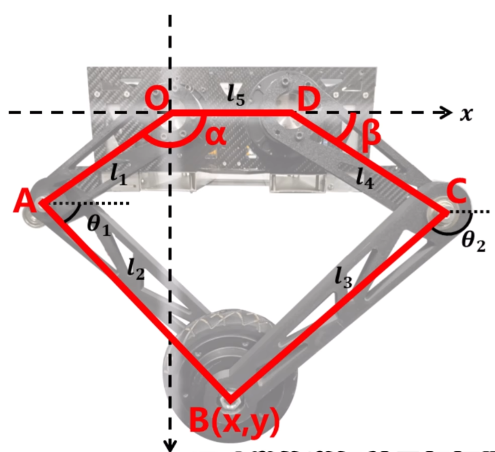

# 平面五连杆轮腿机构 · 运动学

## 0. 符号

- 固定铰：O(0, 0)、D(l5, 0)
- 主动臂：OA = l1，与 +x 轴夹角 α；DC = l4，与 +x 轴夹角 β
- 连杆：AB = l2，CB = l3
- 末端：B(x, y)，即轮心
- θ1、θ2：AB、CB 与 +x 轴正向的夹角
- 角度一律弧度，逆时针为正；长度同一单位

## 1. 三个基本工具

**① 极坐标转直角坐标**（P 相对 Q 距 r、方向角 θ）

<table><tr><td>$$x_P = x_Q + r\cos\theta,\qquad y_P = y_Q + r\sin\theta$$</td></tr></table>

**② 万能半角代换**

任何「一次正余弦方程」 $a\cos\theta + b\sin\theta = c$ 都能化成二次方程。令

<table><tr><td>$$z = \tan\frac{\theta}{2},\qquad \cos\theta = \frac{1-z^2}{1+z^2},\qquad \sin\theta = \frac{2z}{1+z^2}$$</td></tr></table>

代入原式、两边同乘 (1 + z²)，整理得

<table><tr><td>$$(a+c)\,z^2 - 2b\,z + (c-a) = 0$$</td></tr></table>

判别式：

<table><tr><td>$$\Delta = (2b)^2 - 4(a+c)(c-a) = 4(a^2+b^2-c^2)$$</td></tr></table>

所以有实数解的条件是 a² + b² − c² ≥ 0。

**③ 反代回角度**

<table><tr><td>$$\theta = 2\arctan\frac{b \pm \sqrt{a^2+b^2-c^2}}{a+c}$$</td></tr></table>

编程时写成 `2*atan2(b ± √(a²+b²−c²), a+c)`：atan2 同时解决分母为零和象限丢失两个问题，普通 arctan 两个都会出错。

## 2. 正运动学：已知 α、β 求 B(x, y)

**路线**：先算肘点 → 两条路各写一次 B → 消 θ2 → 半角代换解 θ1 → 回代。

**① 肘点**

<table><tr><td>$$x_A = l_1\cos\alpha,\quad y_A = l_1\sin\alpha,\qquad x_C = l_5+l_4\cos\beta,\quad y_C = l_4\sin\beta$$</td></tr></table>

**② 两路写 B**

从 A 走：

<table><tr><td>$$x = x_A + l_2\cos\theta_1,\qquad y = y_A + l_2\sin\theta_1$$</td></tr></table>

从 C 走：

<table><tr><td>$$x = x_C + l_3\cos\theta_2,\qquad y = y_C + l_3\sin\theta_2$$</td></tr></table>

**③ 消 θ2**

B 到 C 的距离恒为 l3，把从 A 走的式子代进 (x − xC)² + (y − yC)² = l3²，整理得一次正余弦方程：

<table><tr><td>$$a\cos\theta_1 + b\sin\theta_1 = c$$</td></tr></table>

其中

<table><tr><td>$$a = 2l_2(x_A-x_C),\qquad b = 2l_2(y_A-y_C),\qquad c = l_3^2 - l_2^2 - l_{AC}^2$$</td></tr></table>

（lAC 为 A、C 间距。）

**④ 解 θ1 并回代**

<table><tr><td>$$\theta_1 = 2\arctan\frac{b \pm \sqrt{a^2+b^2-c^2}}{a+c}$$</td></tr></table>

<table><tr><td>$$x = l_1\cos\alpha + l_2\cos\theta_1,\qquad y = l_1\sin\alpha + l_2\sin\theta_1$$</td></tr></table>

**要点**：给定 (α, β) 时 θ1 只有 ± 两支，对应肘部「撑开 / 内折」一对镜像形态，由装配窗口取唯一支。正解没有多解爆炸，是一条干净映射。

## 3. 逆运动学：已知 B(x, y) 求 α、β

**路线**：含 α 的项留左边、θ1 项挪右边 → 平方相加消 θ1 → 半角代换 → 求根。β 侧完全对称（原点换成 D，l1→l4，l2→l3）。

**① 对 α 的方程**

<table><tr><td>$$2x l_1\cos\alpha + 2y l_1\sin\alpha = x^2 + y^2 + l_1^2 - l_2^2$$</td></tr></table>

即 a cos α + b sin α = c，其中

<table><tr><td>$$a = 2x l_1,\qquad b = 2y l_1,\qquad c = x^2 + y^2 + l_1^2 - l_2^2$$</td></tr></table>

**② 对 β 的方程**

令 u = x − l5：

<table><tr><td>$$d\cos\beta + e\sin\beta = f$$</td></tr></table>

其中

<table><tr><td>$$d = 2u l_4,\qquad e = 2y l_4,\qquad f = u^2 + y^2 + l_4^2 - l_3^2$$</td></tr></table>

**③ 逆解核心公式**

<table><tr><td>$$\alpha = 2\arctan\frac{b \pm \sqrt{a^2+b^2-c^2}}{a+c},\qquad \beta = 2\arctan\frac{e \pm \sqrt{d^2+e^2-f^2}}{d+f}$$</td></tr></table>

**要点**：α、β 各两支，两两组合共 4 组解；α 的两支关于 OB 镜像，β 的两支关于 DB 镜像。逆解是「多对一」，必须靠区间判断挑回装配允许的那一组。

## 4. 可达工作空间

判别式非负，就是三角形 O-A-B 的三边能围成三角形：

<table><tr><td>$$a^2+b^2-c^2 \ge 0 \iff |l_1-l_2| \le \sqrt{x^2+y^2} \le l_1+l_2$$</td></tr></table>

- B 到 O 的距离必须落在 l1、l2 能勾到的圆环里；
- 右臂同理，B 到 D 的距离要落在 l4、l3 的圆环里；
- 两个圆环的交集，才是整机可达域。判别式为负 = 目标点根本到不了。

## 5. 多组解怎么选

1. **归一化**：把角度统一到 [0, 2π) 或 (−π, π] 再比较；两角之差大于 π 时减去 2π，保证比的是最短夹角。
2. **装配过滤**：每个关节的实际行程由连杆、限位决定，区间外的解直接删掉。全部落空说明目标点不可达。
3. **连续性**：还剩两支时，取与上一帧夹角最小的那支。
4. **死区**：切换边界附近，只有新解明显更优才切换，避免来回跳。

「跟 90° 比大小」只是某台机器装配区间的简写，换机器要重新量。

## 6. 关节角与电机角

<table><tr><td>$$\theta_{motor} = i\,\theta_{joint} + \theta_{offset}$$</td></tr></table>

- i：减速比，输出轴转一圈，电机轴转 i 圈；
- θoffset：关节处于建模零位时的电机读数，逐台标定；
- 符号：由电机安装方向决定，同侧镜像安装的两台，一个取 +，一个取 −。

## 7. 在整机里的位置

- 正解：编码器读关节角 → 正解 → 当前足端位置，用于状态估计；
- 逆解：期望足端轨迹 → 逆解 → 关节角 → 电机角 → 指令；
- 雅可比矩阵 J 把关节速度映射为末端速度，也把末端力映射为关节力矩：

<table><tr><td>$$\dot{x} = J\dot{q},\qquad \tau = J^{\mathrm T}F$$</td></tr></table>

## 8. 常见错误

| # | 现象 | 原因 | 处理 |
|---|---|---|---|
| 1 | 腿折向反方向 | 取了镜像支 | 按装配区间筛，逐关节确认 |
| 2 | 算出来是 NaN | 判别式 a² + b² − c² < 0 | 先用第 4 节的不等式判断 |
| 3 | 轨迹突然弹一下 | 相邻帧在两支之间跳变 | 取与上一帧最近的解，并做角度折算 |
| 4 | 角度越算越大 | 没有归一到同一区间 | 统一到 [0, 2π) 或 (−π, π] |
| 5 | 动作整体缩小 i 倍 | 关节角当成了电机角 | 乘减速比 i，再加零位 |
| 6 | 所有轨迹偏一个固定角 | 零位没标定 | θoffset 逐台实测 |
| 7 | 个别轴反向 | 建模、电机、绘图正方向不一致 | 统一一套约定，逐轴验证 |
