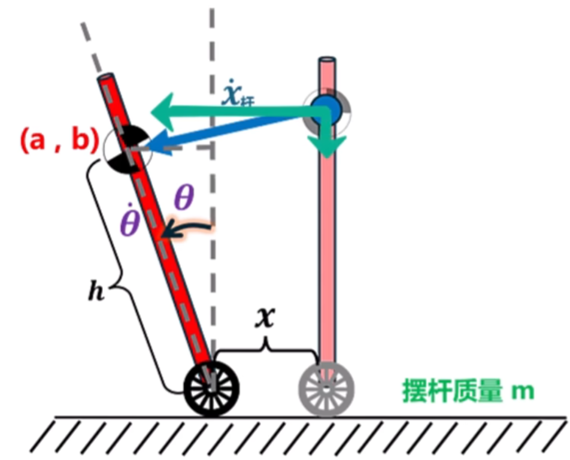

# 轮式倒立摆到 LQR 最优控制：完整学习笔记

> **学习范围**：从简化轮式倒立摆的物理建模、拉格朗日动力学、线性化、矩阵求逆与状态空间模型，延伸到 LQR 的代价函数、Q/R 权重、MATLAB 设计流程。
>
> **模型边界**：这里使用的是用于学习控制理论的简化轮式倒立摆模型，不是达妙五连杆并联腿轮腿机器人的完整动力学模型。

---

# 第一部分：模型与状态变量

## 1. 为什么 LQR 需要系统模型？

LQR 不是直接根据“机器人倾斜了多少”来猜测电机应该输出多大力矩，而是先建立系统模型，描述状态和控制输入之间的关系。

本阶段的目标是得到线性状态空间模型：

$$
\boxed{\dot X=AX+BU}
$$

- $X$：状态向量；
- $\dot X$：状态变化率；
- $A$：系统矩阵，描述系统自身的动态规律；
- $B$：输入矩阵，描述控制输入对状态变化率的影响；
- $U$：控制输入。

可以把右侧理解为：

- $AX$：系统自身状态所产生的动态影响；
- $BU$：控制输入所产生的影响。

## 2. 模型参数与符号约定

| 符号 | 含义 |
|---|---|
| $x$ | 轮轴的水平位置 |
| $\theta$ | 机身相对竖直方向的倾角 |
| $M$ | 轮子及底部部分的等效质量 |
| $m$ | 机身质量 |
| $h$ | 轮轴到机身质心的距离 |
| $I$ | 机身绕自身质心的转动惯量 |
| $r$ | 车轮半径 |
| $g$ | 重力加速度 |
| $\tau$ | 电机输出力矩 |
| $Q_x,Q_\theta$ | 对应广义坐标的广义力 |
| $\Delta$ | 质量矩阵的行列式 |

**符号必须保持一致： $m$ 始终表示机身质量， $M$ 始终表示底部等效质量， $h$ 始终表示质心距离。**

## 3. 广义坐标与状态向量

系统的广义坐标为：

$$
q=
\begin{bmatrix}
x\\
\theta
\end{bmatrix}
$$

本课程采用以下状态排列：

$$
\boxed{
X=
\begin{bmatrix}
x\\
\theta\\
\dot x\\
\dot\theta
\end{bmatrix}
}
$$

对应的状态导数为：

$$
\boxed{
\dot X=
\begin{bmatrix}
\dot x\\
\dot\theta\\
\ddot x\\
\ddot\theta
\end{bmatrix}
}
$$

位置和角度描述“当前在哪里、倾斜多少”；速度和角速度描述“正在怎样运动”。控制器需要这些信息，才能区分静止倾斜与快速倾倒。

---

# 第二部分：拉格朗日动力学建模

## 4. 拉格朗日方法

拉格朗日量：

$$
\boxed{L=T-V}
$$

其中 $T$ 是总动能， $V$ 是总势能。

对广义坐标 $q_i$，拉格朗日方程为：

$$
\boxed{
\frac{d}{dt}\left(\frac{\partial L}{\partial \dot q_i}\right)
-\frac{\partial L}{\partial q_i}
=Q_i
}
$$

本模型有两个广义坐标 $x$ 和 $\theta$，因此分别建立两个方程。

## 5. 质心位置与速度

根据当前坐标约定：

$$
\boxed{x_c=x+h\sin\theta}
$$

$$
\boxed{y_c=h\cos\theta}
$$

对时间求导：

$$
\boxed{
\dot x_c=\dot x+h\cos\theta\dot\theta
}
$$

$$
\boxed{
\dot y_c=-h\sin\theta\dot\theta
}
$$

## 6. 动能

系统动能由底部平动、机身质心平动和机身绕质心转动三部分组成：

$$
T=
\frac12M\dot x^2
+\frac12m(\dot x_c^2+\dot y_c^2)
+\frac12I\dot\theta^2
$$

代入质心速度：

$$
\begin{aligned}
T={}&\frac12M\dot x^2\\
&+\frac12m\left[
(\dot x+h\cos\theta\dot\theta)^2
+(-h\sin\theta\dot\theta)^2
\right]\\
&+\frac12I\dot\theta^2
\end{aligned}
$$

利用 $\sin^2\theta+\cos^2\theta=1$，整理得：

$$
\boxed{
T=
\frac12(M+m)\dot x^2
+mh\cos\theta\dot x\dot\theta
+\frac12(I+mh^2)\dot\theta^2
}
$$

## 7. 势能与拉格朗日量

机身质心高度为 $y_c=h\cos\theta$，所以：

$$
\boxed{V=mgh\cos\theta}
$$

由 $L=T-V$：

$$
\boxed{
\begin{aligned}
L={}&
\frac12(M+m)\dot x^2
+mh\cos\theta\dot x\dot\theta\\
&+\frac12(I+mh^2)\dot\theta^2
-mgh\cos\theta
\end{aligned}
}
$$

## 8. 对 $x$ 使用拉格朗日方程

先求对速度的偏导：

$$
\frac{\partial L}{\partial\dot x}
=(M+m)\dot x+mh\cos\theta\dot\theta
$$

对时间求导，第二项使用乘积法则：

$$
\boxed{
\frac{d}{dt}\left(\frac{\partial L}{\partial\dot x}\right)
=(M+m)\ddot x
+mh\cos\theta\ddot\theta
-mh\sin\theta\dot\theta^2
}
$$

因为 $L$ 中没有显式出现 $x$：

$$
\frac{\partial L}{\partial x}=0
$$

代入拉格朗日方程：

$$
\boxed{
(M+m)\ddot x
+mh\cos\theta\ddot\theta
-mh\sin\theta\dot\theta^2
=Q_x
}
$$

## 9. 对 $\theta$ 使用拉格朗日方程

先求对角速度的偏导：

$$
\frac{\partial L}{\partial\dot\theta}
=mh\cos\theta\dot x+(I+mh^2)\dot\theta
$$

对时间求导：

$$
\begin{aligned}
\frac{d}{dt}\left(\frac{\partial L}{\partial\dot\theta}\right)
={}&-mh\sin\theta\dot\theta\dot x\\
&+mh\cos\theta\ddot x
+(I+mh^2)\ddot\theta
\end{aligned}
$$

再求对角度的偏导：

$$
\frac{\partial L}{\partial\theta}
=-mh\sin\theta\dot x\dot\theta
+mgh\sin\theta
$$

代入拉格朗日方程后，两个交叉项抵消，得到：

$$
\boxed{
mh\cos\theta\ddot x
+(I+mh^2)\ddot\theta
-mgh\sin\theta
=Q_\theta
}
$$

## 10. 完整非线性动力学方程

$$
\boxed{
\begin{cases}
(M+m)\ddot x+mh\cos\theta\ddot\theta
-mh\sin\theta\dot\theta^2=Q_x\\
mh\cos\theta\ddot x+(I+mh^2)\ddot\theta
-mgh\sin\theta=Q_\theta
\end{cases}
}
$$

这两个方程描述轮轴平动与机身转动之间的耦合。

---

# 第三部分：线性化与矩阵求逆

## 11. 在直立平衡点附近线性化

选择直立平衡点：

$$
\boxed{\theta=0}
$$

小角度近似（角度使用弧度）：

$$
\sin\theta\approx\theta,\qquad
\cos\theta\approx1
$$

项 $\sin\theta\dot\theta^2$ 在一阶线性化中属于高阶小量，忽略。得到：

$$
\boxed{
(M+m)\ddot x+mh\ddot\theta=Q_x
}
$$

$$
\boxed{
mh\ddot x+(I+mh^2)\ddot\theta-mgh\theta=Q_\theta
}
$$

注意：重力项 $-mgh\theta$ 是一阶项，必须保留。

## 12. 写成质量矩阵形式

把加速度项放在左侧：

$$
\boxed{
\begin{bmatrix}
M+m&mh\\
mh&I+mh^2
\end{bmatrix}
\begin{bmatrix}
\ddot x\\
\ddot\theta
\end{bmatrix}=
\begin{bmatrix}
Q_x\\
Q_\theta+mgh\theta
\end{bmatrix}
}
$$

定义质量矩阵：

$$
H=
\begin{bmatrix}
M+m&mh\\
mh&I+mh^2
\end{bmatrix}
$$

非对角元素 $mh$ 表示水平平动与机身转动之间存在惯性耦合。

## 13. 行列式与二阶矩阵求逆

对于一般二阶矩阵：

$$
H=
\begin{bmatrix}
a&b\\
c&d
\end{bmatrix}
$$

其行列式为：

$$
\boxed{\Delta=ad-bc}
$$

这里的 $\Delta$ 就是矩阵的行列式。二阶矩阵的逆矩阵公式为：

$$
\boxed{
H^{-1}
=\frac{1}{ad-bc}
\begin{bmatrix}
d&-b\\
-c&a
\end{bmatrix}
}
$$

对当前质量矩阵：

$$
\boxed{
\Delta=(M+m)(I+mh^2)-(mh)^2
}
$$

因此：

$$
\boxed{
H^{-1}
=\frac1\Delta
\begin{bmatrix}
I+mh^2&-mh\\
-mh&M+m
\end{bmatrix}
}
$$

当 $\Delta\ne0$ 时，矩阵可逆。注意：质量矩阵可逆与系统可控是两个不同概念。

## 14. 为什么要求逆矩阵？

原方程是：

$$
H
\begin{bmatrix}
\ddot x\\
\ddot\theta
\end{bmatrix}=
\begin{bmatrix}
Q_x\\
Q_\theta+mgh\theta
\end{bmatrix}
$$

为了单独求出两个加速度，两边左乘 $H^{-1}$：

$$
\boxed{
\begin{bmatrix}
\ddot x\\
\ddot\theta
\end{bmatrix}=
H^{-1}
\begin{bmatrix}
Q_x\\
Q_\theta+mgh\theta
\end{bmatrix}
}
$$

---

# 第四部分：从电机力矩得到状态空间模型

## 15. 广义力与电机力矩的关系

在当前简化假设下，电机输出力矩与轮缘切向力满足：

$$
\tau=Fr
$$

所以：

$$
\boxed{F=\frac{\tau}{r}}
$$

因此水平广义力写为：

$$
\boxed{Q_x=\frac{\tau}{r}}
$$

电机对轮子施加力矩时，机身侧会受到反作用力矩。按当前角度和电机正方向约定：

$$
\boxed{Q_\theta=-\tau}
$$

负号取决于正方向定义；改变正方向时符号也会改变。这里的映射是用于教学的简化模型，忽略轮子转动惯量、滚动损耗和其他执行器细节。

## 16. 代入广义力并求出加速度

代入线性化动力学方程：

$$
\begin{cases}
(M+m)\ddot x+mh\ddot\theta=\dfrac{\tau}{r}\\
mh\ddot x+(I+mh^2)\ddot\theta-mgh\theta=-\tau
\end{cases}
$$

整理为矩阵方程：

$$
H
\begin{bmatrix}
\ddot x\\
\ddot\theta
\end{bmatrix}=
\begin{bmatrix}
\tau/r\\
mgh\theta-\tau
\end{bmatrix}
$$

代入逆矩阵：

$$
\begin{bmatrix}
\ddot x\\
\ddot\theta
\end{bmatrix}=
\frac1\Delta
\begin{bmatrix}
I+mh^2&-mh\\
-mh&M+m
\end{bmatrix}
\begin{bmatrix}
\tau/r\\
mgh\theta-\tau
\end{bmatrix}
$$

展开第一行：

$$
\boxed{
\ddot x=
-\frac{m^2gh^2}{\Delta}\theta
+\frac{\frac{I+mh^2}{r}+mh}{\Delta}\tau
}
$$

展开第二行：

$$
\boxed{
\ddot\theta=
\frac{(M+m)mgh}{\Delta}\theta
-\frac{\frac{mh}{r}+(M+m)}{\Delta}\tau
}
$$

## 17. 建立四个状态方程

状态排列固定为：

$$
X=
\begin{bmatrix}
x\\
\theta\\
\dot x\\
\dot\theta
\end{bmatrix},
\qquad
\dot X=
\begin{bmatrix}
\dot x\\
\dot\theta\\
\ddot x\\
\ddot\theta
\end{bmatrix}
$$

因此：

$$
\dot X_1=\dot x,\qquad
\dot X_2=\dot\theta
$$

$$
\dot X_3=
-\frac{m^2gh^2}{\Delta}\theta
+\frac{\frac{I+mh^2}{r}+mh}{\Delta}\tau
$$

$$
\dot X_4=
\frac{(M+m)mgh}{\Delta}\theta
-\frac{\frac{mh}{r}+(M+m)}{\Delta}\tau
$$

这四个方程是从动力学表达式填写矩阵 $A$ 和 $B$ 的依据。

## 18. 从状态方程识别矩阵 A 和 B

标准形式：

$$
\dot X=AX+BU
$$

本模型定义控制输入：

$$
\boxed{U=\tau}
$$

识别规则：

- 方程第几条，对应矩阵的第几行；
- 状态变量在 $X$ 中排第几位，对应矩阵 $A$ 的第几列；
- 控制输入 $U$ 的系数进入矩阵 $B$。

例如， $\theta$ 是状态向量的第二个元素，而 $\dot X_3$ 是第三个状态导数，所以：

$$
A_{32}=-\frac{m^2gh^2}{\Delta}
$$

最终得到：

$$
\boxed{
A=
\begin{bmatrix}
0&0&1&0\\
0&0&0&1\\
0&-\dfrac{m^2gh^2}{\Delta}&0&0\\
0&\dfrac{(M+m)mgh}{\Delta}&0&0
\end{bmatrix}
}
$$

$$
\boxed{
B=
\begin{bmatrix}
0\\
0\\
\dfrac{\frac{I+mh^2}{r}+mh}{\Delta}\\
-\dfrac{\frac{mh}{r}+(M+m)}{\Delta}
\end{bmatrix}
}
$$

所以完整模型为：

$$
\boxed{\dot X=AX+BU,\qquad U=\tau}
$$

维度检查：

$$
A\in\mathbb R^{4\times4},\quad
B\in\mathbb R^{4\times1},\quad
X\in\mathbb R^{4\times1}
$$

如果重新定义输入为 $U=2\tau$，那么 $\tau=U/2$，矩阵 $B$ 中的输入系数就要全部除以 2。

---

# 第五部分：LQR 最优控制

## 19. LQR 是什么？

LQR 全称 Linear Quadratic Regulator，即线性二次型调节器。它基于线性状态空间模型，通过最小化二次型代价函数求出状态反馈增益。

常见反馈控制律：

$$
\boxed{u=-KX}
$$

- $u$：控制器输出；
- $K$：状态反馈增益矩阵；
- $X$：状态向量。

“最优”必须先有评价标准。LQR 同时考虑状态误差和控制输入大小，而不是只追求响应越快越好。

## 20. 代价函数

连续时间、无限时域的标准 LQR 代价函数：

$$
\boxed{
J=\int_0^\infty
\left(X^TQX+u^TRu\right)\,dt
}
$$

- $J$：累计代价；
- $X^TQX$：状态偏差代价；
- $u^TRu$：控制输入代价；
- $Q$：状态权重矩阵；
- $R$：控制输入权重矩阵。

LQR 要寻找使总代价 $J$ 最小的反馈规律。

## 21. Q 矩阵：惩罚状态误差

对于当前四状态模型，常见的一种初始选择是对角矩阵：

$$
Q=
\begin{bmatrix}
q_x&0&0&0\\
0&q_\theta&0&0\\
0&0&q_{\dot x}&0\\
0&0&0&q_{\dot\theta}
\end{bmatrix}
$$

对应状态代价：

$$
\boxed{
X^TQX=
q_xx^2+q_\theta\theta^2
+q_{\dot x}\dot x^2
+q_{\dot\theta}\dot\theta^2
}
$$

- $q_x$：位置偏差权重；
- $q_\theta$：机身倾角偏差权重；
- $q_{\dot x}$：水平速度权重；
- $q_{\dot\theta}$：机身角速度权重。

某个状态越重要、越希望它的偏差小，就可以提高 $Q$ 中对应的权重。例如，希望更重视机身直立，可以提高 $q_\theta$。

## 22. R 矩阵：惩罚控制输入

如果系统只有一个控制输入， $R$ 是正数：

$$
\boxed{R=[r_u],\qquad r_u>0}
$$

输入代价为：

$$
\boxed{u^TRu=r_u u^2}
$$

通常：

- $R$ 增大：控制器更不愿意使用大输入，响应可能更谨慎；
- $R$ 减小：控制器更愿意使用大输入，响应可能更激进，执行器负担也可能增加。

实际效果还取决于系统模型和 $Q$，不能把趋势理解成对所有系统都绝对成立。

## 23. Q 与 R 的权衡

| 权重 | 惩罚对象 | 增大时通常意味着 |
|---|---|---|
| $Q$ | 状态误差 | 更重视状态接近期望值 |
| $R$ | 控制输入 | 更重视减少控制输出 |

不存在适用于所有机器人的固定最佳 $Q$、 $R$。它们取决于结构参数、执行器能力、传感器噪声、响应速度和任务要求。

更一般的代价函数可以包含状态与输入的交叉项：

$$
J=\int_0^\infty
\left(X^TQX+2X^TNu+u^TRu\right)\,dt
$$

本课程先讨论常见的 $N=0$ 情况。

## 24. MATLAB 设计流程

常见流程：

1. 建立线性模型 $\dot X=AX+BU$；
2. 设置 $Q$ 和 $R$；
3. 使用 MATLAB 的 `lqr` 函数求取反馈增益 $K$；
4. 构建闭环系统；
5. 仿真初始状态响应；
6. 检查状态响应、控制输入、超调和执行器限制；
7. 根据结果调整 $Q$、 $R$，重新仿真。

MATLAB 核心调用形式：

```matlab
K = lqr(A, B, Q, R);
u = -K * X;
```

实际部署还需要考虑状态估计、输入限幅、采样周期、执行器接口和安全保护。仿真中得到的理想控制律不能不经处理就直接用于真实机器人。

---

# 第六部分：关键概念与易错点

1. **线性化不是把所有非线性项都删掉。** 要在指定平衡点附近按阶数保留一阶项。
2. **重力项 $-mgh\theta$ 必须保留。** 它是一阶小量。
3. **行列式 $\Delta$ 与矩阵逆不是一回事。** $\Delta$ 是一个数，逆矩阵是一个矩阵； $\Delta$ 出现在逆矩阵的分母中。
4. **质量矩阵可逆不代表系统可控。** 两者判断的是不同性质。
5. **矩阵 A 的列顺序由状态向量顺序决定。** 本文始终采用 $X=[x,\theta,\dot x,\dot\theta]^T$。
6. **矩阵 B 的数值取决于输入定义。** 如果把输入从 $\tau$ 改为 $2\tau$，B 的系数也必须相应改变。
7. **Q 和 R 不是越大越好。** 它们表达状态误差与控制输入之间的权衡。
8. **简化模型不能代替真实五连杆并联腿模型。** 实际机器人还需要考虑腿部自由度、连杆惯量、关节驱动、轮子转动惯量、摩擦和传感器等因素。

---

# 最终知识框架

$$
\boxed{
\text{物理模型}
\rightarrow
\text{拉格朗日方程}
\rightarrow
\text{非线性动力学}
\rightarrow
\text{直立点线性化}
}
$$

$$
\boxed{
\text{质量矩阵求逆}
\rightarrow
\text{求出加速度}
\rightarrow
\text{状态空间 }(A,B)
\rightarrow
\text{LQR }(Q,R,K)
}
$$

**核心逻辑**：先用物理规律建立系统模型，再把模型整理成状态空间形式，最后通过 $Q$ 和 $R$ 表达控制目标，由 LQR 求出反馈增益 $K$。
